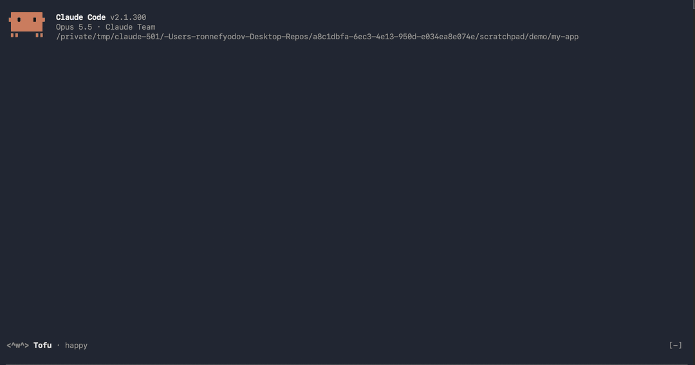

# Prompt library

Save, search and reuse your best prompts.

## Why

You write the same good prompts again and again: review my diff, write tests
for this file, explain this repo. This mod keeps them one command away.

- **Fast.** `/prompts`, type to search, press Send. Most used prompts come first.
- **Templates.** `{{input}}` asks for the file or topic before it sends.
- **Portable.** Export to JSON, share it with your team, import it on another machine.
- **Private.** Prompts stay in the mod's local store. No network calls.

## Use

| Command | What |
|---------|------|
| `/prompts` | Open the library: search, list by most used, preview, Send / Copy / Delete |
| `/prompts save <name>` | Save the last prompt you sent |
| `/prompts save <name> <text>` | Save given text |
| `/prompts delete <name>` | Delete a prompt |
| `/prompts export` | Write `prompts.json` to the current folder (never overwrites) |
| `/prompts import <file>` | Merge prompts from a JSON file (max 512 KB) |

Put `{{input}}` in a prompt and Send asks you for the value first.
Comes with 8 starter prompts (review diff, write tests, explain repo, …).

## Install

    /plugin marketplace add Ron-Nefyodov/prompt-library-mod
    /plugin install prompt-library@prompt-library

Or try it locally: `claude --plugin-dir .`

## Develop

    npm test            # claude plugin test .
    claude plugin validate .
